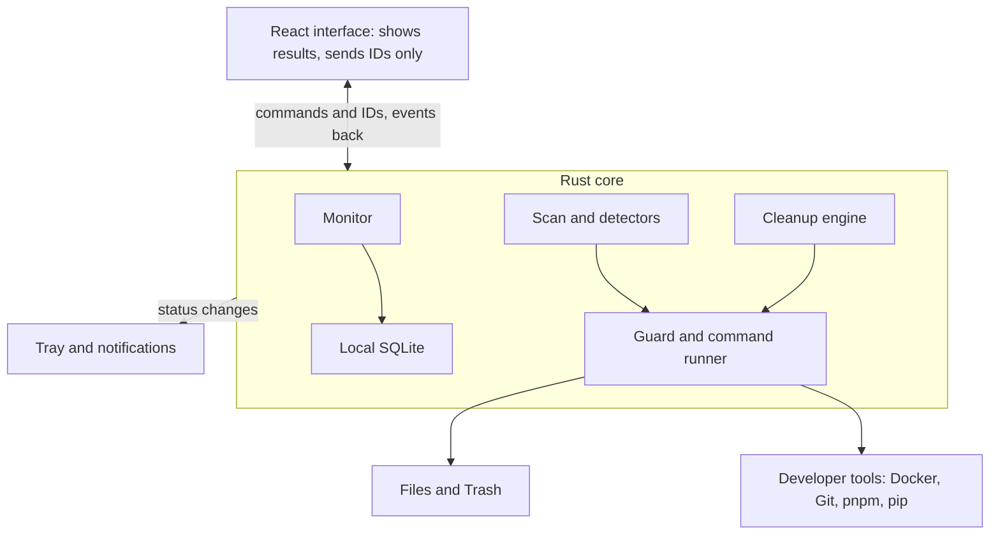
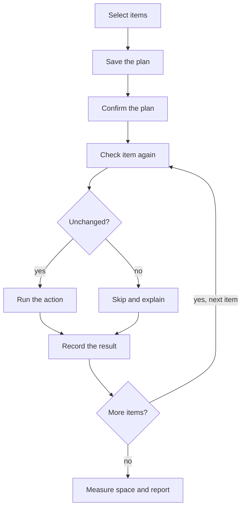

# Freeboard: Product and Implementation Specification

Nov 4, 2026 · @Bogdan

## Overview

Freeboard is a local Tauri 2 desktop app for macOS, Linux and Windows that warns developers before disk space runs out, then shows what can be removed and how risky each removal is. "Freeboard" is the working name.

**Problem:** developer machines fill up with Docker data, Git worktrees, dependencies, build output and package caches. These are spread across many tools, so finding safe space to reclaim is slow and easy to get wrong.

**Primary user:** a developer on a workstation with limited disk space who needs to recover space quickly during normal work.

### Goals

- Show current free space and warn before it becomes critical.
- Find reclaimable resources across developer tools, including worktrees and Docker data.
- Explain each suggestion: what it is, its size, its last known use, its risk and how it would be restored.
- Let the user reclaim space safely, with a preview before every cleanup.
- Stay small and quiet enough to run in the background.

### Non-goals for v1

- Automatic deletion. Freeboard never removes anything without a confirmed plan.
- Cloud accounts, sync, analytics or remote management.
- General PC optimization, such as memory cleaning, registry cleaning or startup management.
- Duplicate-file detection and a full treemap explorer. Both are candidates for a later version.
- Mac App Store distribution, because its sandbox limits whole-disk scanning.

### Performance targets

| Metric | Target |
| --- | --- |
| Installer size | 15 MB or less |
| Memory while hidden in the tray | 40 MB or less, with the webview destroyed |
| CPU while idle | Below 1% averaged over 5 minutes |
| Quick scan | Under 10 seconds |
| Deep scan of 1 million files on an SSD | Under 60 seconds |

These are design targets, not measured results. Report the real numbers at each milestone.

## Instructions for the implementing agent

Implement this specification milestone by milestone, and treat the safety invariants below as stricter than any feature requirement. If a feature conflicts with an invariant, keep the invariant and record the conflict.

1. Complete one milestone at a time and stop when its exit criteria pass.
2. Before relying on a CLI flag or output format, check it against the installed tool. The commands here are design intent, not a guaranteed interface.
3. Pin dependency versions in the lockfiles. Use current stable releases, and do not add a dependency when the standard library is enough.
4. Run scanning and cleanup code only against temporary fixtures during tests. Never run real cleanup commands against the developer's machine.
5. Keep product decisions in `docs/decisions.md`, with the date and reason.
6. If a requirement is unclear and affects deleted data, stop and ask.

### Safety invariants

Every invariant needs at least one automated test.

1. **Scans are read-only.** Detectors may read files and run read-only commands. They must never change anything.
2. **Nothing runs without a confirmed plan.** Cleanup requires a saved plan, and the user must confirm that exact plan.
3. **The backend owns paths and commands.** The frontend sends only plan and suggestion IDs. It never sends a path or command to execute.
4. **Every item is checked again immediately before cleanup.** The check confirms the item's identity, path, modification state and Git or Docker status. If anything changed, skip the item and report why.
5. **Protected paths are never touched.** Reject the filesystem root, home directory, system directories, application directories, repository roots, and `.git` directories or files. Canonicalize the path first and test against the canonical form.
6. **Symlinks and junctions are never followed.** Never follow them while scanning or deleting. Removing a link removes only the link.
7. **Dangerous commands are banned.** Do not call `git worktree remove --force`, `git clean`, `docker system prune --all`, or `docker volume prune`.
8. **Commands run without a shell.** Use an executable and an argument array, with no string interpolation.
9. **Git work is never preselected.** Uncommitted or unpushed work is `Risky`. It is shown for awareness and blocked from cleanup in v1.
10. **Docker volumes are never preselected.** Volumes can hold unique data. Each one requires individual confirmation.
11. **Unknown means less safe.** If a status check fails or times out, raise the risk level. Never assume an item is safe.
12. **All data stays local.** Freeboard makes no network calls in v1, except those made by developer tools it runs on request.
13. **Every action leaves a record.** Store the plan, each item result, and the before and after free space in local history.

One exception applies to invariant 7. `docker builder prune` and `docker image prune` stop to ask for confirmation, so the backend may pass `--force` to these two commands after the user has confirmed the plan. It only skips Docker's prompt. No other command may use a force flag.

### Delete and restore policy

The recovery method must be visible before confirmation, because moving items to the Trash does not free space until the Trash is emptied.

| Risk | Default action | Frees space immediately | Recovery |
| --- | --- | --- | --- |
| Safe | Native cleanup command, or permanent delete of regenerable data | Yes | Regenerate with the owning tool |
| Review | Move to Trash where possible; use a native command for Docker and Git items | Trash: only after emptying; native: yes | Restore from Trash, or recreate if the item used a native command |
| Risky | Blocked or individually confirmed, depending on the detector | Depends on the action | State the exact recovery, or "not recoverable" |

The plan must show three totals: space freed immediately, space held in the Trash, and items that cannot be recovered.

## Technical stack and architecture

Freeboard is a Tauri 2 app with a Rust core that does all scanning and cleanup, and a React interface that only displays results and sends IDs back. The Rust core keeps running in the tray after the webview is destroyed.



All filesystem and command access passes through the guard and runner, which is where the safety invariants are enforced.

| Layer | Choice | Purpose |
| --- | --- | --- |
| Shell | Tauri 2 | Windows, tray icon, notifications, packaging |
| Core | Rust stable, Tokio | Scans, detectors, monitoring, cleanup |
| Interface | React, TypeScript, Vite | Screens only, with no filesystem or command access |
| Filesystem walking | `jwalk` | Parallel directory traversal |
| Free space | `sysinfo` | Volume capacity and free space |
| Local storage | SQLite through `rusqlite` | Settings, samples, plans and history |
| Trash | `trash` crate | Trash on macOS, Linux and Recycle Bin on Windows |
| Logging | `tracing` | Local rotating logs, with no file contents |

### Tauri permissions

- Do not grant the frontend the shell or filesystem plugins.
- Grant only the app's own commands, plus notification and autostart permissions.
- Set a strict content security policy, with no remote scripts or remote content.

### Repository layout

```text
freeboard/
├── src/                    # React screens and components
│   ├── screens/            # overview, suggestions, plan, history, settings
│   ├── components/
│   └── lib/                # typed wrappers around Tauri commands
├── src-tauri/
│   ├── capabilities/
│   └── src/
│       ├── commands/       # thin Tauri command handlers
│       ├── monitor/        # free-space sampling, status and forecast
│       ├── scan/           # scan orchestration and size measurement
│       ├── detectors/      # docker, worktrees, projects, caches, files
│       ├── cleanup/        # plans, safety checks, execution
│       ├── platform/       # macOS, Linux and Windows differences
│       ├── runner.rs       # the only module that starts external commands
│       ├── guard.rs        # protected-path checks
│       ├── store.rs        # SQLite access and migrations
│       └── tray.rs
├── tests/fixtures/
└── docs/decisions.md
```

## Data model and risk rules

Every detector returns the same `Suggestion` shape, so the interface and cleanup engine never need tool-specific logic. Risk comes from the rules below, not from size or age alone.

```ts
type Risk = "safe" | "review" | "risky";
type Action = "native_command" | "delete" | "trash" | "none";

interface Suggestion {
  id: string;              // stable hash of detector ID and resource identity
  detector: string;        // for example "docker.build_cache"
  category: "docker" | "worktrees" | "builds" | "caches" | "files";
  title: string;
  location: string;        // path or tool-level description
  sizeBytes: number;       // actual on-disk size
  lastUsedAt: string | null;
  lastUsedLabel: string;
  risk: Risk;
  action: Action;
  actionLabel: string;     // the exact command or file action shown to the user
  reason: string;
  recovery: string;
  recoverable: boolean;
  blockedReason: string | null;
  needsConfirmation: boolean;
  fingerprint: string;     // used by the pre-cleanup check
}

interface CleanupPlan {
  id: string;
  createdAt: string;
  expiresAt: string;       // 30 minutes after creation
  itemIds: string[];
  bytesFreedNow: number;
  bytesHeldInTrash: number;
  unrecoverableIds: string[];
}
```

### Risk levels

| Risk | Meaning | Preselected | Examples |
| --- | --- | --- | --- |
| Safe | Fully regenerable, and the owning tool or a lockfile can rebuild it | Yes | Docker build cache, `target`, pnpm unreferenced packages |
| Review | Probably unneeded, but it depends on the user's context | No | Merged worktrees, unused tagged images, old installers |
| Risky | May contain unique work or data | Never | Dirty worktrees, Docker volumes |

### Ordering

Group suggestions by category and sort each group by size, largest first. The overview's main action uses the total of Safe items.

### Measuring size

- Report actual on-disk size, not apparent size. Use `st_blocks` on macOS and Linux, and `GetCompressedFileSizeW` on Windows.
- Count each hard-linked file once, using device and inode or the Windows volume and file IDs.
- For pnpm-managed `node_modules`, show only space that removal would really free.
- Show `about` before a size when the tool can't report it exactly.

### Local storage

| Table | Contents | Retention |
| --- | --- | --- |
| `settings` | User settings as key and JSON value | Permanent |
| `free_space_samples` | Volume, time, free bytes and total bytes | Hourly for 30 days |
| `suggestions` | Results of the latest scan | Replaced on each scan |
| `cleanup_runs` | Plan, times and before and after free space | 1 year |
| `cleanup_items` | Item snapshot, action, result and skip reason | 1 year |

## Scans and detectors

Freeboard runs a light quick scan on a schedule and a deeper scan on request, and each detector can fail without stopping the others. If a tool is missing or not running, show that state and continue.

| Scan | What it does | Runs | Target |
| --- | --- | --- | --- |
| Quick | Reads tool reports and known cache locations | Every hour by default | Under 10 seconds |
| Deep | Walks the configured folders to find projects, worktrees and files | On request, or daily if enabled | Under 60 seconds for 1 million files |

All external commands run through `runner.rs`, with a 20-second default timeout. A timeout marks that detector as unavailable.

### Detector summary

| Detector | Finds | Default risk | Action | Platforms |
| --- | --- | --- | --- | --- |
| `docker.build_cache` | Unused build cache | Safe | `docker builder prune` | All |
| `docker.dangling_images` | Untagged, unused images | Safe | `docker image prune` | All |
| `docker.unused_images` | Tagged images with no container | Review | `docker image rm <image>` | All |
| `docker.stopped_containers` | Containers stopped for 14+ days | Review | `docker container rm <id>` | All |
| `docker.volumes` | Volumes with no container | Risky | `docker volume rm <name>`, with individual confirmation | All |
| `git.worktrees` | Linked worktrees | Review or Risky | `git worktree remove <path>` | All |
| `project.dependencies` | `node_modules`, `.venv` | Safe or Review | Delete or Trash | All |
| `project.build_output` | `target`, `dist`, `build`, `.next` | Safe | Delete | All |
| `cache.pnpm` | Unreferenced packages | Safe | `pnpm store prune` | All |
| `cache.pip` | Download cache | Safe | `pip cache purge` | All |
| `cache.npm` | npm content cache | Safe | Delete `_cacache` | All |
| `cache.homebrew` | Old downloads | Safe | `brew cleanup` | macOS, Linux |
| `cache.cargo` | Registry and Git download caches | Review | Trash | All |
| `cache.gradle` | Gradle caches | Review | Trash, only when no Gradle daemon is running | All |
| `cache.xcode` | DerivedData | Safe | Delete | macOS |
| `cache.simulators` | Unavailable iOS simulators | Review | `xcrun simctl delete unavailable` | macOS |
| `files.installers` | Old installers and disk images in Downloads | Review | Trash | All |
| `files.windows_temp` | Old files in `%TEMP%` | Review | Recycle Bin | Windows |

`npm cache clean` requires a force flag, which is not an allowed exception, so the npm detector removes the cache folder through the normal safety checks.

### Docker

- Check `docker version` first. If Docker isn't installed or running, show that and skip the Docker detectors.
- Read data with `docker system df`, `docker image ls`, `docker ps -a` and `docker volume ls`, using JSON output where available.
- Treat an image as used if any container references it, including stopped containers.
- Treat a volume as attached if any container mounts it, including stopped containers.
- Never use `docker system prune`.

### Git worktrees

Discover repositories under the configured folders, then read each one with `git worktree list --porcelain`. Never suggest the main worktree.

| State | Risk | Cleanup |
| --- | --- | --- |
| Clean and merged into the default branch | Review | Allowed |
| Clean, pushed, not merged | Review | Allowed |
| Uncommitted or untracked files | Risky | Blocked |
| Unpushed commits, or no upstream | Risky | Blocked |
| Locked worktree | Risky | Blocked |
| In the middle of a merge or rebase | Risky | Blocked |
| Currently open in a detected process | Risky | Blocked |
| Status can't be determined | Risky | Blocked |

Git cannot reliably detect squash merges, so show those branches as "pushed, not merged".

### Projects

Suggest generated folders only when ownership is clear, so an unrelated folder named `build` is never included.

| Folder | Required evidence | Risk |
| --- | --- | --- |
| `node_modules` | `package.json` and a lockfile beside it | Safe |
| `target` | `Cargo.toml` beside it | Safe |
| `.venv` | `pyproject.toml` or `requirements.txt` beside it | Review |
| `dist`, `build`, `.next` | A project manifest beside it, and the folder ignored by Git | Safe |

A project counts as inactive when none of its source files have changed for 30 days. Skip projects with a running process in that folder, and never scan inside the generated folders themselves.

### Old files

For Downloads, suggest `.dmg`, `.pkg`, `.exe`, `.msi`, `.AppImage`, `.deb`, `.rpm` and `.iso` files that have not been opened or modified for 90 days. Do not suggest documents or media in v1.

## Cleanup and monitoring

Cleanup is one confirmed run of a saved plan, and any item that changed since the scan is skipped rather than removed. Monitoring warns on status changes only, so the app doesn't nag.



Each item is checked on its own, so one changed item doesn't stop the rest of the plan.

### Cleanup rules

- The backend builds and stores the plan, then returns its totals and contents to the interface.
- A plan expires after 30 minutes, or sooner if a new scan runs. Confirmation of an expired plan is rejected.
- Each `needsConfirmation` item requires its own acknowledgment before the plan can be confirmed.
- Only one cleanup can run at a time.
- The user can cancel between items. Cancellation never interrupts an item already running.
- If one item fails, record the error and continue with the next item.
- After the run, measure free space again and report the measured change as well as the expected total.
- A skipped item stays in Suggestions and shows why it was skipped.

### Pre-cleanup checks

| Resource | Checks immediately before cleanup |
| --- | --- |
| All paths | Canonical path, protected-path rules, no symlink swap, same fingerprint |
| Worktree | Still clean, still pushed or merged, not locked, no new commits |
| Project folder | Manifest still present, no process running in the project |
| Docker image or volume | Still unused by every container |
| Docker container | Still stopped |

### Trash

Items moved to the Trash remain listed as space held in the Trash until the user empties them or removes them outside Freeboard. Emptying affects only items Freeboard moved there and requires a separate confirmation. If a volume or system has no usable Trash, stop that item and offer permanent deletion as a new, separately confirmed plan.

### Disk status

Freeboard monitors the home volume by default, plus any other fixed volumes the user adds. It samples free space every 5 minutes in memory and stores one sample each hour.

| Status | Default rule | Tray icon | Notification |
| --- | --- | --- | --- |
| Healthy | 20 GB free or more | Neutral ring | None |
| Low | Below 20 GB | Amber ring | Once on entering Low |
| Critical | Below 8 GB | Red ring | On entering Critical, then every 6 hours while unchanged |

A status improves only after free space rises 2 GB above its threshold, which stops repeated alerts around the limit. Clicking a notification opens Suggestions.

### Forecast

Calculate the daily change with a linear fit over the last 14 days of samples. Show "About N days left" only when there are at least 3 days of samples and free space is falling. Exclude cleanup jumps from the fit. Otherwise, show no forecast.

### Background behavior

- Closing the window hides it to the tray, and the webview is destroyed after 60 seconds hidden.
- Monitoring and scheduled quick scans continue in Rust.
- Deep scans run at low priority and pause on battery power by default.
- The tray menu offers Open Freeboard, Scan Now, Pause Notifications and Quit.

## Interface and app contract

The interactive prototype, `freeboard-prototype.html` in this folder, is the reference for screens and flow. Its numbers are sample data, not requirements, and its hull gauge is the intended main visual.

| Screen | Must show | Main actions |
| --- | --- | --- |
| Tray | Status ring and free space | Open, Scan Now, Pause Notifications, Quit |
| Overview | Hull gauge, status, free space, forecast, space by category and risk, 14-day trend | Review Safe items, Scan Now |
| Suggestions | Items by category with size, last use, risk, reason, action and recovery | Filter by risk, select items, review plan |
| Cleanup plan | Space freed right away, space held in Trash, unrecoverable items, resulting free space | Acknowledge risks, confirm, change selection |
| Cleanup run | Per-item check and result, skip reasons, final measured result | Cancel, empty Trash items, plan another cleanup |
| History | Date, items, space freed, Trash amount, skipped items | Open run details |
| Settings | Thresholds, scan schedule, folders, exclusions, startup and notifications | Change settings |

The gauge shows the top 120 GB of the disk, with the deck line at 0 GB free and the waterline rising as space runs out. Mark Low and Critical on the hull. Status must always appear in text as well as color.

### Tauri commands

| Command | Input | Returns |
| --- | --- | --- |
| `get_status` | None | Volumes, status, forecast, Trash total |
| `start_scan` | `kind` | `scanId` |
| `get_suggestions` | Optional filters | `Suggestion[]` |
| `create_plan` | `itemIds` | `CleanupPlan` |
| `acknowledge_item` | `planId`, `itemId` | Updated plan |
| `run_plan` | `planId` | `runId` |
| `cancel_run` | `runId` | Accepted or not |
| `empty_freeboard_trash` | Confirmation token | Result |
| `list_history` | Page | Run summaries |
| `get_settings` | None | `Settings` |
| `update_settings` | Partial settings | `Settings` |

### Events

| Event | Payload |
| --- | --- |
| `status_changed` | Volume, status, free bytes |
| `scan_progress` | Scan ID, phase, detector, current count |
| `scan_finished` | Scan ID, detector errors, totals |
| `cleanup_item_updated` | Run ID, item ID, state, reason |
| `cleanup_finished` | Run ID, measured bytes freed, skipped count |

### Default settings

| Setting | Default |
| --- | --- |
| Low threshold | 20 GB |
| Critical threshold | 8 GB |
| Quick scan | Every hour |
| Deep scan | Only on request |
| Inactive project | 30 days |
| Old installer | 90 days |
| Pause deep scans on battery | On |
| Start at login | On |
| Notifications | On |
| Scan folders | Chosen during first run |

The first run explains what Freeboard reads, asks for scan folders, and requests any operating system permission only when a feature needs it.

## Delivery plan

Build the read-only product first, because cleanup should only arrive once its suggestions have proven reliable. Each milestone must pass on macOS, Linux and Windows before the next one starts.

### Platform notes

| Platform | Requirements |
| --- | --- |
| macOS | Request Full Disk Access only for protected locations. Report APFS purgeable space and local snapshots separately, because totals may differ from Finder. Sign and notarize release builds. |
| Linux | Test tray behavior on GNOME and KDE. Test WebKitGTK early. Respect XDG cache and data locations. Ship AppImage and `.deb` first. |
| Windows | Treat junctions and reparse points as links. Support long paths. Use the Recycle Bin for Trash actions. Sign release builds to reduce SmartScreen warnings. |
| Docker Desktop | Pruned space may stay inside its virtual disk, so show the measured change instead of promising the expected amount. Do not compact virtual disks in v1. |
| WSL | Don't scan WSL filesystems in v1. Show their virtual disk files as large items only when found. |

### Milestones

1. **Foundation:** create the Tauri app, permissions, SQLite storage, tray, settings and CI builds on all three platforms.
   - Exit: installers build, and the frontend cannot reach filesystem or shell APIs.
2. **Monitoring:** add free-space sampling, status rules, notifications, forecast, Overview and background mode.
   - Exit: thresholds and hysteresis are tested, and hidden-mode memory is measured.
3. **Read-only detection:** add the scan engine, size measurement, all detectors and Suggestions.
   - Exit: fixture tests pass, and no scan changes any fixture.
4. **Cleanup:** add plans, pre-cleanup checks, execution, Trash handling, cancellation and History.
   - Exit: every safety invariant has a passing test.
5. **Release readiness:** add first-run setup, performance work, accessibility, signing and documentation.
   - Exit: every acceptance criterion below passes.

### Test plan

- **Unit tests:** risk rules, protected paths, size counting, status thresholds, forecast and plan expiry.
- **Fixture tests:** Git repositories for every worktree state, project folders, symlink traps, and a fake `docker` executable.
- **Change-during-cleanup tests:** add a commit, modify a file, start a container and swap a path for a symlink between scan and cleanup.
- **Failure tests:** missing tools, command timeouts, permission errors and malformed JSON.
- **Contract tests:** the frontend cannot execute a path or command directly.
- **Manual checks:** tray, notifications, Trash and permissions on real macOS, Linux and Windows machines.

### Acceptance criteria

- [ ] The tray shows correct status and free space on macOS, Linux and Windows.
- [ ] Crossing Low or Critical sends exactly one notification under the rules above.
- [ ] Suggestions cover Docker, Git worktrees, dependencies, build output, caches and old installers.
- [ ] Every suggestion shows its size, risk, reason, action and recovery.
- [ ] Dirty, unpushed, locked and unknown-state worktrees can't be selected.
- [ ] Docker volumes are never preselected and need individual acknowledgment.
- [ ] The plan separates space freed now, space held in Trash and unrecoverable items.
- [ ] Items that changed after the scan are skipped and explained.
- [ ] Cleanup results show measured free-space changes.
- [ ] A failed or missing tool does not stop other detectors.
- [ ] Every safety invariant has an automated test.
- [ ] The app makes no network calls of its own.
- [ ] Performance results are reported against the targets in the overview.

### Open questions

- Will Freeboard be open source? If so, which license?
- Which operating system should get the first signed release?
- Is Freeboard the final name after domain, package and trademark checks?

## Sources

- [Tauri vs. Electron vs. Deno Desktop vs. Electrobun (Better Stack)](https://betterstack.com/community/guides/scaling-nodejs/tauri-vs-electron-vs-deno-vs-electrobun/)
- [Desktop App Frameworks 2026 (Youngju Kim)](https://www.youngju.dev/split/culture/2026-05-14-desktop-app-frameworks-2026-tauri-electron-wails-compose-multiplatform-maui-flutter-comparison-deep-dive-2026)
- [dua-cli package details (Debian)](https://dfsg-new-queue.debian.org/reviews/dua-cli)
- [diskr-cli README](https://docs.rs/crate/diskr-cli/1.0.0/source/README.md)
